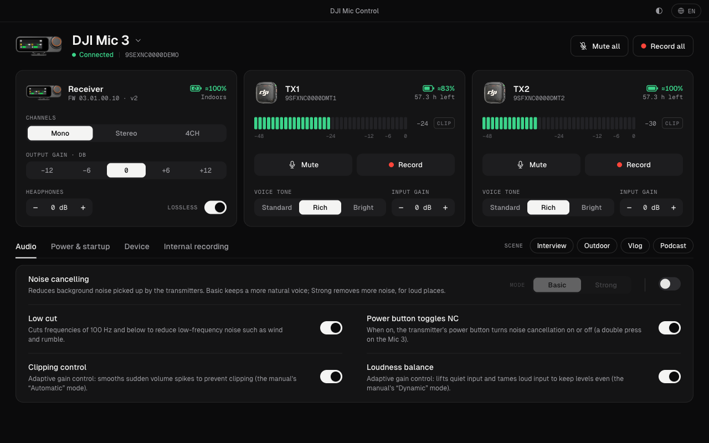
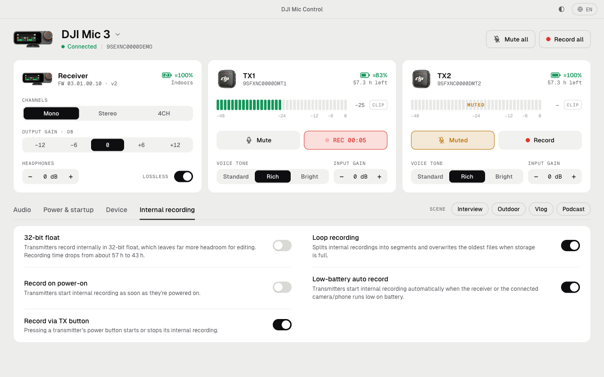
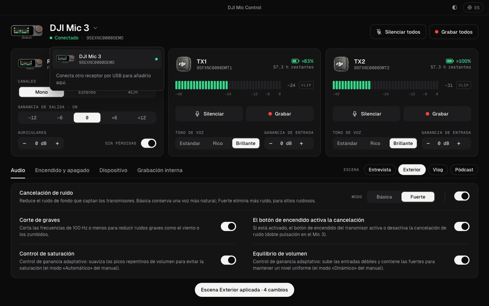

# DJI Mic Control

Control your DJI wireless microphones from the computer over USB — no phone,
no DJI Mimo app. Plug the receiver in and every setting, live levels, mute,
internal recording and battery status are right there.

This is a fork of [ShadowBitBasher/DJI-Mic-Control](https://github.com/ShadowBitBasher/DJI-Mic-Control)
that adds **DJI Mic 3** support, a redesigned interface and six languages.



<table>
  <tr>
    <td></td>
    <td></td>
  </tr>
  <tr>
    <td align="center"><sub>Light theme · TX1 recording, TX2 muted</sub></td>
    <td align="center"><sub>Spanish · device switcher and scene presets</sub></td>
  </tr>
</table>

## Download

**[⬇ DJI Mic Control 1.2.0 for macOS (Apple Silicon)](https://github.com/qubik89/DJIMic3/releases/download/v1.2.0/DJI-Mic-Control_1.2.0_macOS_arm64.dmg)**
· [all releases](https://github.com/qubik89/DJIMic3/releases)

1. Open the `.dmg` and drag **DJI Mic Control** to **Applications**.
2. The app isn't signed with an Apple developer account, so macOS may say it
   is "damaged". Clear the quarantine flag once:
   ```bash
   sudo xattr -rd com.apple.quarantine "/Applications/DJI Mic Control.app"
   ```
3. Connect the receiver with a USB-C cable and open the app.

Windows and Linux builds aren't published yet; [build them from source](#build-from-source).

## Features

- **Live channel strips** per transmitter: segmented level meter with peak hold
  and a clip indicator, Mute and Record buttons with a running timer, voice
  tone and input gain.
- **Receiver controls**: channel mode (mono / stereo / 4-channel), output gain,
  headphone volume, lossless audio, battery and indoor/outdoor environment.
- **Quick actions**: mute or record on every transmitter at once.
- **Scenes**: Interview, Outdoor, Vlog and Podcast presets that change several
  settings in one click (only what differs is sent).
- **All the settings**, grouped in tabs with an explanation under each one:
  noise cancelling, low cut, clipping control, loudness balance, auto-off,
  camera power sync, LEDs, vibration, 32-bit float, loop recording, automatic
  recording triggers…
- **Battery** for the receiver and every transmitter (≈ percentage), plus the
  internal recording time left on each transmitter.
- **Clock sync**: the transmitters' clock is set on connect so internal
  recordings get correct timestamps.
- **Dark and light themes**, following the system by default.
- **Languages**: English, Español (España), Français, Italiano, Deutsch and
  Nederlands. The app starts in the system language and can be changed from
  the globe button; the tray and macOS menus follow it.
- **Menu bar / tray** shortcuts for LEDs and noise cancelling, with a
  low-battery warning.
- **Command line tool** (`djimic`) for scripting.

## Supported devices

| Device | Status |
| --- | --- |
| **DJI Mic 3** (receiver `2ca3:4015`, `2ca3:4115` in 4-channel mode) | Full control, tested with firmware 03.01.00.10 and two transmitters. Up to four transmitters are supported but only two were tested. |
| **DJI Mic Mini** / **Mic Mini 2** transmitters (receiver `2ca3:4011`) | Supported by the original project (v1 and v2 firmware). |

Not available on the Mic 3 because the hardware doesn't offer it: Safety Track
(DJI replaced it with 32-bit float internal recording). Not yet implemented:
timecode, monitor source selection, dual-file recording, formatting the
transmitters' storage, and changing the indoor/outdoor environment (it's
shown, but has to be changed on the receiver).

Battery percentages are estimates: the microphones only report seven battery
levels. Level-meter dB values are approximate too.

## Command line

```bash
cargo run -p cli -- list
cargo run -p cli -- status
cargo run -p cli -- set noise-cancel strong
cargo run -p cli -- set --tx 1 voice-tone rich
cargo run -p cli -- set lossless on
```

`djimic status` shows every setting and its current value; the setting ids are
defined in `crates/protocol/src/models/`.

## Platform notes

**macOS** works out of the box (see [Download](#download)).

**Linux** needs a udev rule for non-root USB access. The `.deb`/`.rpm` install
it; otherwise:

```bash
sudo cp packaging/60-dji-mic.rules /etc/udev/rules.d/
sudo udevadm control --reload-rules && sudo udevadm trigger
```

Then replug the receiver. The app shows these steps if it can't access the
device.

**Windows** binds the receiver's control interface to its own driver, so it has
to be switched to WinUSB with [Zadig](https://zadig.akeo.ie/): interface 6 on
the Mic Mini, interface 4 (`com.dji.mic`) on the Mic 3 (untested on Windows).
Replug the receiver afterwards.


## Build from source

Requirements: Rust 1.77+ and Node.js 18+ (Linux also needs the WebKitGTK/GTK
development packages Tauri requires).

```bash
./build-release.sh            # macOS/Linux → Release/<os>/ (.app + .dmg, or .deb/.rpm/.AppImage)
./build-release.ps1           # Windows
```

For development, from `gui/`:

```bash
npm install
npm run tauri dev
```

Always launch the GUI through `tauri dev`; a bare debug binary loads its
frontend from the dev server and shows a blank window. Run the tests with
`cargo test`.

The release script sets path-remapping `RUSTFLAGS` so binaries don't embed the
build machine's home directory, and checks the result.

## Project layout

```
crates/protocol   Framing, CRC, commands, status decoding, per-model settings (Mic Mini, Mic 3)
crates/device     USB transport (nusb), command ACK/retry, multi-device manager
crates/cli        djimic command-line tool
gui               Tauri v2 app (Rust backend in src-tauri, Svelte 5 frontend)
packaging         Linux udev rule shipped in the .deb/.rpm
docs/screenshots  README images
```

Adding a setting means editing one model definition in `crates/protocol`; the
CLI and GUI pick it up automatically. The wire protocol, including everything
learned about the Mic 3, is documented in [PROTOCOL.md](PROTOCOL.md).

## Credits

- [ShadowBitBasher/DJI-Mic-Control](https://github.com/ShadowBitBasher/DJI-Mic-Control):
  the original app, protocol work and Mic Mini support.
- [SanMurakami/mic3-bridge](https://github.com/SanMurakami/mic3-bridge) and
  [usokawa/dji-mic-mo](https://github.com/usokawa/dji-mic-mo): command ids that
  were cross-checked while mapping the Mic 3.
- Translation structure based on the Simplified Chinese proposal in the
  upstream repository (PR #3).

Not affiliated with or endorsed by DJI. DJI and DJI Mic are trademarks of SZ
DJI Technology Co., Ltd.; product images are used to identify the devices.

## License

Released into the public domain under [The Unlicense](LICENSE). Third-party
dependencies keep their own licenses; their notices are included in
distributed binaries.
